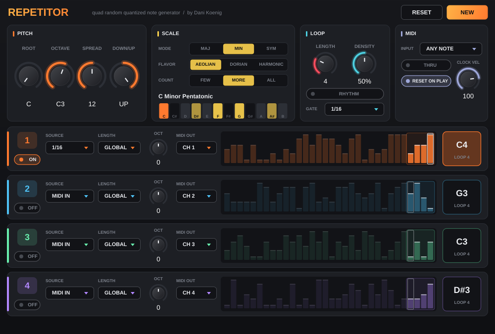

# Repetitor

Free quad random quantized note generator for macOS (Apple Silicon), VST3 and Audio Unit (MIDI FX).
By Dani Koenig. Inspired by the Noise Engineering Gamut Repetitor Eurorack module, rebuilt as a MIDI effect: MIDI in, MIDI out.



## How it works

Send in notes (or use the internal clock) and turn Length up. Every trigger creates a random note in the chosen scale.
When you hear something you like, turn Length down to loop the most recent notes (1 to 32 steps) and loop away.

## Features

- **4 channels**, each on its own MIDI channel (default 1-4), with its own colour and step display
- **Trigger source per channel**: MIDI IN (every incoming note is a trigger, like the module's normalled inputs) or an internal clock synced to the DAW tempo (1/32 to 1 bar, triplets)
- **Input mode**: ANY NOTE triggers all MIDI IN channels, or C1-D#1 for one note per channel
- **Pitch**: Root, Octave, Spread (0 to 24 semitones), Down/Up (above, around or below the root), Octave offset per channel
- **27 scales** on three switches like the module: MAJ / MIN / SYM, Flavor, Count (few, more, all notes)
- **Length**: INF = always new notes; 1, 2, 3, 4, 5, 6, 8, 12, 16, 24, 32 = loop the most recent notes. Colour like the module LED: red = divisible by 2, blue = by 3, violet = both. Global or per channel
- **Rhythm mode**: random repeating rhythm instead of pass-through, Density sets how many steps play. The rhythm is part of the loop
- **Gate**: INPUT (as long as the incoming note) or 1/64 to 1/2
- **NEW** rolls new notes, **RESET** restarts all loops on the next trigger, optional reset when the DAW starts
- Scale, Root and Spread changes are applied live to the loop
- Loops are saved with the project

The 27 scales (family / flavor / count):

| | Few | More | All |
|---|---|---|---|
| MAJ Ionian | Major Triad | Major Pentatonic | Major |
| MAJ Lydian | Major 7 | Lydian Pentatonic | Lydian |
| MAJ Mixo | Dominant 7 | Dominant Pentatonic | Mixolydian |
| MIN Aeolian | Minor Triad | Minor Pentatonic | Minor |
| MIN Dorian | Minor 7 | Dorian Pentatonic | Dorian |
| MIN Harmonic | Minor Major 7 | Hirajoshi | Harmonic Minor |
| SYM Aug | Augmented Triad | Augmented Hexatonic | Whole Tone |
| SYM Dim | Tritone | Diminished 7 | Octatonic |
| SYM Chroma | Octaves | Fifths | Chromatic |

## Use

- **Bitwig**: put Repetitor on an instrument track before the instrument.
- **Logic Pro**: MIDI FX slot > Audio Units > Dani Koenig > Repetitor.
- Ableton Live does not support MIDI effect plugins.

## Install

Download the latest release: [Releases](https://github.com/danikoenig/Repetitor/releases).
`Repetitor-Installer.pkg` installs VST3 and AU. See [INSTALL.txt](INSTALL.txt).

## Build

```
cmake -B build -DCMAKE_BUILD_TYPE=Release -DCMAKE_OSX_ARCHITECTURES=arm64
cmake --build build --config Release --target Repetitor_VST3 Repetitor_AU
```

JUCE 8.0.4 is downloaded automatically. GitHub Actions builds every push on `main`; a tag `v*` or a commit message with `[release]` creates a release.

Local engine test (triggers, scales, loop, rhythm, clock, state):

```
cmake -B build -DREPETITOR_TEST_SRC=tests/EngineTest.cpp
cmake --build build --target RepetitorTest && ./build/RepetitorTest
```
